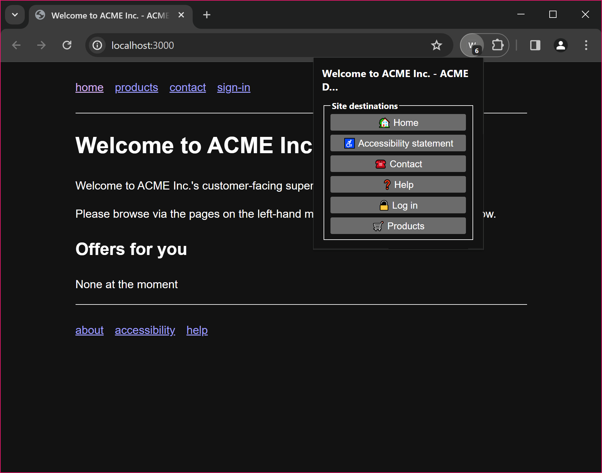

# WAI-Adapt: Discoverable Destinations Explainer

## Authors

- Matthew Tylee Atkinson (@matatk), Samsung Electronics

## Participate

* Issues: https://github.com/w3c/adapt/issues
* Discussions: https://github.com/w3c/adapt/discussions

## Contents

<!-- toc -->

- [Introduction](#introduction)
- [Motivating Use Cases](#motivating-use-cases)
- [The "Discoverable Destinations" Approach](#the-discoverable-destinations-approach)
- [Alternatives Considered](#alternatives-considered)
  * [Well-known URIs](#well-known-uris)
  * [Sitemaps](#sitemaps)
  * [Using `rel` attribute values alone](#using-rel-attribute-values-alone)
  * [Linksets](#linksets)
- [Open Questions](#open-questions)
  * [Indicating the kind of content](#indicating-the-kind-of-content)
  * [Discoverability and repetition](#discoverability-and-repetition)
- [Stakeholder feedback/opposition](#stakeholder-feedbackopposition)
- [References and acknowledgements](#references-and-acknowledgements)

<!-- tocstop -->

## Introduction

<!-- _[Overall WAI-Adapt Explainer](README.md)_ -->

Web sites can contain a huge array of varied and engaging content. This content, and the means of navigating around it, can be presented in almost any way, which makes for tailored and compelling experiences. However, whilst there are several conventions when it comes to navigation, this variability can pose challenges to certain people and user agents acting on their behalf.

This work aims to address the challenge of making sites more easily navigable for both people (particularly those facing accessibility barriers) and machines. It does this by standardising machine-readable names for common page types. User Agents can then query as to which destinations are supported on a given site and present this information in an appropriate way for the user.

The User Agent, or a User Agent extension, could provide an interface to allow the user to view supported common pages using a method and terminology that is clear to them, and to request to visit common destination pages directly.

The technical details, full use cases, and authoring guidance are documented in the [WAI-Adapt: Discoverable Destinations W3C Note](../destinations/index.html).

The motivating use cases, the "option 1" approach (using Well-known URIs), and an example end-user UI are depicted in the [Discoverable Destinations AC 2024 lightning talk](https://w3c.github.io/adapt/presentations/ac2024/).

## Motivating Use Cases

* Supporting people facing cognitive accessibility barriers in navigating sites.

  - This includes mechanisms that can support clear signposting within a User Agent to "standard" or "common" areas of sites that users wish to visit, such as "log in", "products", or the site's accessibility statement.

  - This also includes supporting users and accessibility auditors in quickly discovering the accessibility statement for a site.

* Allowing UAs, or other machines, acting on behalf of users to also find common areas of sites.

A proof-of-concept UI for enumerating a site's discoverable destinations is depicted below.

The full set of use cases is documented in the [WAI-Adapt: Discoverable Destinations W3C Note](../destinations/index.html#use-cases).

## The "Discoverable Destinations" Approach

The approach uses HTML `<link>` elements with custom `rel` attribute values to signpost discoverable destinations on each page of a site. The proposed set of destination types (such as `accessibility-statement`, `help`, `log-in`, and `search`) comes from work done by the [Cognitive and Learning Disabilities Accessibility Task Force](https://www.w3.org/WAI/GL/task-forces/coga/).

The technical details of the approach, including the destination namespace, how to enumerate and update destinations, how to express sub-destination links, and how to demarcate destination content using ARIA landmarks, are all specified in the [W3C Note](../destinations/index.html#the-discoverable-destinations-approach).

The Task Force has agreed to adopt the `<link>` element approach for the first iteration of this specification. This decision reflects that the approach has a low entry barrier, builds on existing and well-understood HTML mechanisms, and can be incrementally adopted. The per-page repetition, while an authoring overhead, can be managed in practice through CMS templates.

### Sub-site scope

A site hosted at a single origin may contain functionally distinct sub-sites (for example, a hotel website that hosts both a main booking section and a restaurant section). Each sub-site may need its own set of destinations that differ from those of the root site.

The per-page `<link>` approach handles this naturally. Because every page carries its own `<link>` declarations, each sub-site simply includes the destinations relevant to that sub-site. The User Agent always reads the destinations from the current page, so scope is implicit and automatic, overriding destinations is straightforward, and no additional authoring mechanism is needed.

The Task Force considers sub-site demarcation to be resolved by the per-page `<link>` approach.

## Alternatives Considered

### Well-known URIs

We first explored using [Well-known URIs](https://datatracker.ietf.org/doc/html/rfc8615), which provide a number of useful features. However, there were some important limitations:

* Well-known URIs are linked to an origin, which means it is not possible to demarcate sub-sites.

* Well-known URIs are usually managed separately from site content, making it harder for regular content authors to keep them up to date.

### Sitemaps

[Sitemaps](https://www.sitemaps.org/) are intended to solve different problems than this work.

* Sitemaps are intended to enumerate all major pages; the goal here is to highlight specific common pages that may be provided.

* Sitemaps do not give standard names to certain types of pages; the goal here is to semantically identify the purpose of specific pages so that the UA can present this information to the user, and so that machines can reach certain pages.

It does not seem like a good fit to try to extend the format of sitemaps to accommodate these requirements.

### Using `rel` attribute values alone

Using `rel` attribute values is part of the proposed approach, for cases where deep links may be provided into an overall well-known section (for example, help on a specific topic).

It would be possible to use only `rel` values to highlight discoverable destinations if they were applied to links to the top-level destination landing pages, and if there was a way to denote that a link was to the top-level destination landing page. However, this would have the disadvantage that the overall destinations for a particular site could not be determined, nor presented to the user, in a simple and robust way. The user could only discover them if they landed on the right pages.

This would pose the risk that the interface presented by the UA would not give a complete picture of what is available on the site, and would thus either not be of great use, or be actively confusing for people to use.

> [!NOTE]
> Open questions:
>
> * How often would footer links cover this? (If often, does that negate the need for this spec?)
>
> * What is the performance cost of parsing all those `rel` attributes every time? (This would be required if the `rel` approach were to be used at all.)

### Linksets

This was the Task Force's favoured approach before TPAC 2024. Linksets are semantically equivalent to the `<link>` element approach. They would require some additional authoring work to create the linkset, and would result in smaller pages, with one extra request for the linkset document that would cover the whole site.

The Task Force opted for the `<link>` element approach for simplicity. However, it would still be possible to use linksets in future.

Each discoverable destination would be part of a vocabulary namespaced under a root URL, for example `https://w3.org/voc/ia/` (with "ia" standing for "information architecture"). The first time the user visits an origin, the linkset for the origin and sub-sites would be fetched from a well-known URI such as `/.well-known/ia/linkset`.

## Open Questions

### Indicating the kind of content

The current proposal identifies where a destination is located but does not convey what kind of support or content it offers. This matters for users with cognitive disabilities who may need a specific type of interaction — for example, speaking to a human over the phone rather than engaging with a chatbot or submitting a form by email.

Options under consideration include:

* Extending the `rel` value vocabulary to include more specific destination subtypes (for example, `help-human` or `help-chat`). This is directly discoverable by User Agents but risks combinatorial explosion as the number of content kinds grows.

* Using an additional attribute or a companion `<meta>` element alongside the `<link>` element to annotate the kind of support offered, keeping the destination identifier stable.

* Deferring this concern to the destination page itself, where structured data markup could describe the available support types. This places the burden on page authors and requires User Agents to fetch and parse the destination page before presenting options.

This remains unresolved and may be deferred to a future iteration of this work.

### Discoverability and repetition

The current approach requires all `<link>` destination elements to be repeated in the `<head>` of every page on the site. This has the advantage of simplicity: a User Agent can read the available destinations from the current page without making any additional HTTP requests. However, it introduces authoring overhead and requires every page to be updated whenever a destination URL changes.

The Task Force has agreed to adopt the `<link>` element approach for the first iteration of this specification. This decision reflects that the approach has a low entry barrier, builds on existing and well-understood HTML mechanisms, and can be incrementally adopted. The per-page repetition can be managed in practice through CMS templates.

Options under consideration for future iterations include:

* A single canonical discovery endpoint, such as a well-known URI, that a User Agent can consult once per origin rather than reading destinations from each page. This would reduce per-page overhead but would require an additional HTTP request on first visit.

* If a centralised endpoint is added, how per-page and per-origin declarations would be reconciled when they differ — for example, when a sub-site legitimately overrides a root-level destination.

* What caching expectations should apply to destination declarations in both the per-page `<link>` approach and any centralised discovery document.

The [Linksets](https://www.rfc-editor.org/rfc/rfc9264) format offers one possible path toward centralised discovery and may be revisited in a subsequent iteration.

## Stakeholder feedback/opposition

> [!NOTE]
> We are actively involved in early discussions with some stakeholders, and will seek wide review as soon as possible.

## References and acknowledgements

* The WAI-Adapt TF

* Abhinav Kumar

* Léonie Watson

* Phil Archer

* The COGA TF

* Tantek Çelik

* Theresa O'Connor

### Foundational and related work

#### Destinations

* [Destinations that Adapt inherited from COGA](https://raw.githack.com/w3c/adapt/CR-content-2022-07-26/content/index.html#values-0)

> [!NOTE]
> As mentioned above, the destinations are under review.

#### Link types/relations

* HTML's [standard link types](https://html.spec.whatwg.org/multipage/links.html#linkTypes)

* Extended link types (also known as "link relations"):

  - [Link types managed by the Microformats project](https://html.spec.whatwg.org/multipage/links.html#other-link-types)

  - [Link types managed by IANA](https://www.iana.org/assignments/link-relations/link-relations.xhtml)

#### Linksets

> [!NOTE]
> We are not using linksets in the spec, though they were suggested to us as a suitable implementation path. They provide a slightly more centralised semantic equivalent to `<link>` elements, which can be separated out into a separate document. They would likely require slightly more authoring effort initially.

* [IETF's Linksets RFC](https://www.rfc-editor.org/rfc/rfc9264)

* [GS1's linkset visualisation demo](https://gs1.github.io/linkset/)
